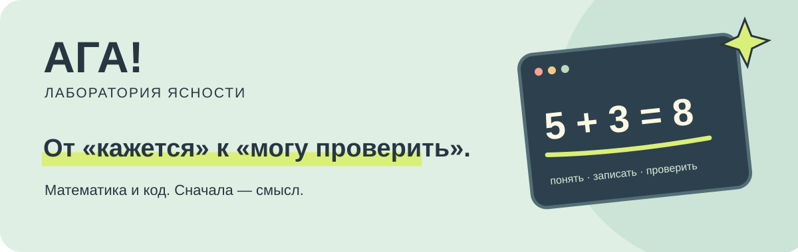

  

<strong>Идеи уже есть. Научимся превращать их в реальность — и проверять то, что получилось.</strong>

  <a href="https://lotargo.github.io/Teacher-/">Открыть АГА! ↗</a> &nbsp; · &nbsp;
  <a href="https://lotargo.github.io/Teacher-/math/">Математика</a> &nbsp; · &nbsp;
  <a href="https://lotargo.github.io/Teacher-/workshop/">Мастерская</a> &nbsp; · &nbsp;
  <a href="https://lotargo.github.io/Teacher-/library/">Библиотека</a>

---

## Не обязательно быть программистом, чтобы создавать своё

У сантехника может быть идея сайта для записи клиентов. У механика — приложение для заказов. У кого-то — желание оживить игру детства, собрать полезный инструмент для работы или наконец разобраться, почему ИИ выбрал именно такое решение.

**АГА!** существует для них. И для тех, кто пока только догадывается о собственных возможностях.

Это не школа с обещаниями трудоустройства, не фабрика сертификатов и не марафон по заучиванию синтаксиса. Здесь можно в своём темпе развивать четыре навыка:

| Понимать | Пробовать | Создавать | Проверять |
| --- | --- | --- | --- |
| Разбирать повседневные задачи и полезную математику | Учиться на коротких интерактивных историях | Превращать идеи в проекты, в том числе с ИИ | Замечать неверные допущения, ошибки и риски |

Не каждый должен писать код с нуля. Но каждому, кто что-то создаёт, полезно понимать, **что сделано, почему и можно ли этому доверять**.

### Найти собственный путь

**[Практика](https://lotargo.github.io/Teacher-/courses/)** — первое знакомство с логикой, числами и кодом, без школьных предпосылок.

**[Математика для жизни](https://lotargo.github.io/Teacher-/math/)** — проценты, покупки, запасы, время и понятные вычисления.

**[Мастерская идей](https://lotargo.github.io/Teacher-/workshop/)** — от человеческого замысла к проверяемому заданию для ИИ и первому прототипу.

**[Библиотека](https://lotargo.github.io/Teacher-/library/)** — короткие авторские материалы и тщательно выбранные внешние ресурсы.

### Бесплатно. Без сертификатов. Без искусственных барьеров.

АГА! — открытый проект. Внутри нет аккаунтов и платного доступа. Прогресс вводного знакомства остаётся в браузере. Разделы будут пополняться по мере появления **реального** содержания: не ради количества курсов и красивых обещаний.

<strong>Миру нужны не только те, кто умеют задавать вопросы. Нужны те, кто могут проверять ответы и менять мир вокруг себя.</strong>

### Пикси пока отдыхает

Помощница Пикси временно отключена, пока мы проверяем более стабильное подключение к ИИ. Кнопка Пикси не загружается, и сайт не обращается к облачной модели при посещении страниц. Исходники и иллюстрации сохранены для будущего возвращения.

**Остальные разделы работают без неё:** уроки, калькуляторы и локальная мастерская. Прогресс хранится только в браузере. Подробности — в **[вопросах и ответах](https://lotargo.github.io/Teacher-/faq/)**.
